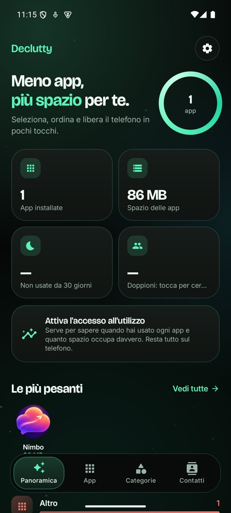
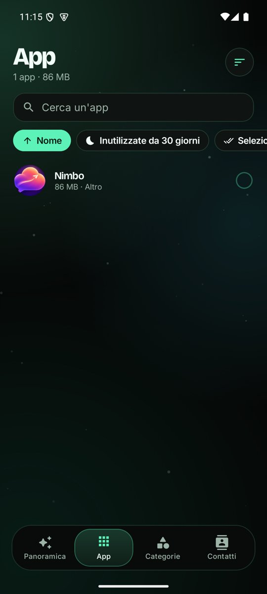
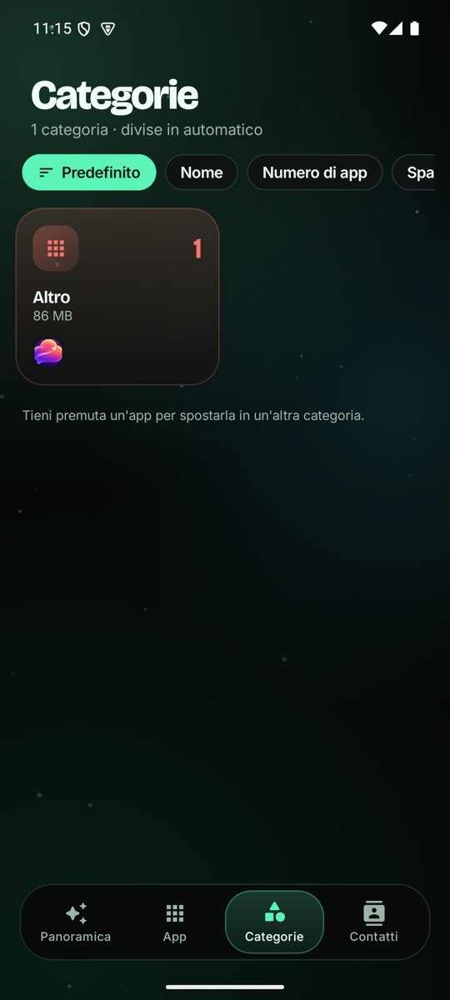
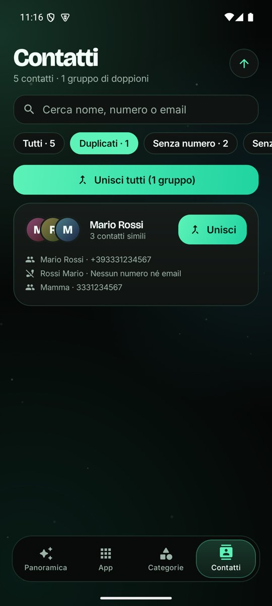
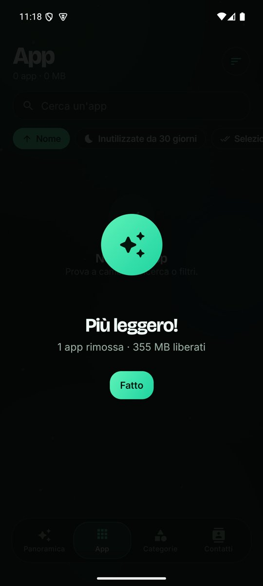

# Declutty

**Decluttering digitale per Android: meno app, meno doppioni, meno foto inutili, più spazio.**

  
  
  
  
  

## Cosa fa

- 🧹 **Disinstalla più app insieme**: selezionale, tocca Disinstalla e Declutty le passa una dopo l'altra alla finestra di conferma di Android, poi ti dice quanto spazio hai liberato.
- ↕️ **Ordina come vuoi**: per nome, dimensione, data di installazione, ultimo aggiornamento o ultimo utilizzo, in ordine crescente o decrescente.
- 💤 **Trova le app dimenticate**: il filtro "Inutilizzate da 30 giorni" mostra quelle che non apri più.
- 🗂️ **Categorie automatiche**: le app vengono divise da sole in Comunicazione, Social, Finanza, Giochi, Foto e altre. Le categorie si ordinano per nome, numero di app o spazio, e un'app si sposta a mano tenendola premuta.
- 🙈 **Nascondi app da Declutty**: quelle che non vuoi vedere spariscono dagli elenchi (restano installate) e si recuperano da Impostazioni → App nascoste.
- 🖼️ **Foto simili**: confronta ogni foto con quelle scattate nello stesso momento, riconosce raffiche, scatti ripetuti e copie identiche, sceglie la migliore (nitidezza, esposizione, risoluzione) e propone di eliminare le altre. Le foto finiscono nel cestino di Android (recuperabili per 30 giorni) o vengono eliminate definitivamente, sempre dopo la conferma di sistema. Le preferite sono protette, la sensibilità e il periodo di confronto si regolano in Impostazioni → Foto simili, e le scansioni successive analizzano solo le foto nuove. Serve Android 11 o successivo.
- 👥 **Contatti**: elimina più contatti insieme, filtra quelli senza numero o senza nome e unisci i doppioni (stesso nome, numero o email) in un tocco, uno alla volta o tutti insieme.
- 🔄 **Aggiornamenti in-app**: in Impostazioni → Aggiornamenti Declutty legge l'ultima release di questa repository, scarica l'APK e apre l'installazione. Quando c'è una nuova versione compare anche un avviso nella Panoramica.

Tutto resta sul telefono, foto comprese: Declutty usa internet solo per controllare gli aggiornamenti.

## Permessi

| Permesso | Perché |
|---|---|
| Elenco delle app installate | Mostrare, ordinare e dividere per categoria le tue app |
| Richiesta di disinstallazione | Aprire la conferma di Android per ogni app |
| Foto e video (lettura) | Cercare le foto simili, solo se apri la scheda Foto |
| Contatti (lettura e scrittura) | Eliminare e unire i contatti, solo se apri la scheda Contatti |
| Accesso ai dati di utilizzo (facoltativo) | Ultimo utilizzo e spazio reale di ogni app |
| Installazione di app | Installare gli aggiornamenti di Declutty |

## Installazione

Scarica `Declutty-vX.Y.Z.apk` dall'[ultima release](https://github.com/carellice/declutty/releases/latest) e aprilo sul telefono. Android 8.0 o successivo.

## Pubblicare una release

Doppio clic su **`rilascia.bat`** (oppure `rilascia.bat minor` / `major`): incrementa la versione, esegue i test, compila l'APK firmato, crea commit e tag e pubblica la release su GitHub con l'APK allegato.

Serve la cartella privata `.release/` con la chiave di firma (`declutty.jks` e `signing.properties`): non è nel repository, va conservata con un backup. Senza la stessa chiave Android rifiuta gli aggiornamenti.

Requisiti: Git, GitHub CLI autenticata, JDK 17+ e Android SDK.

## Licenza

MIT — Flavio Ceccarelli
